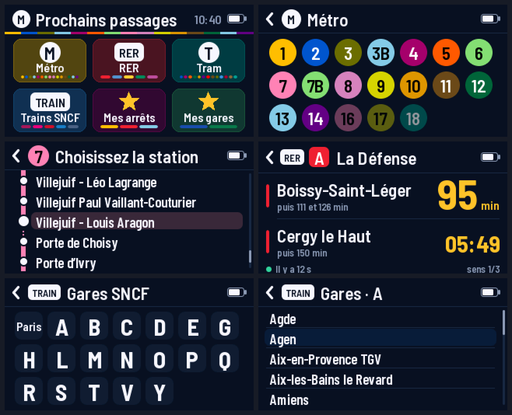
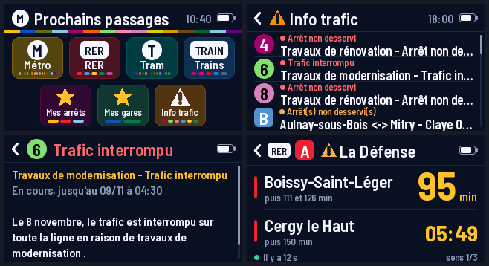
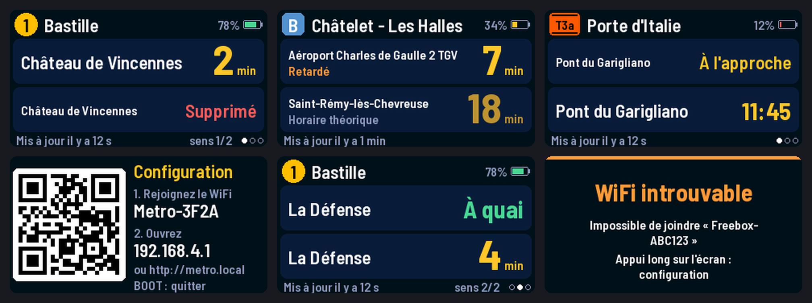
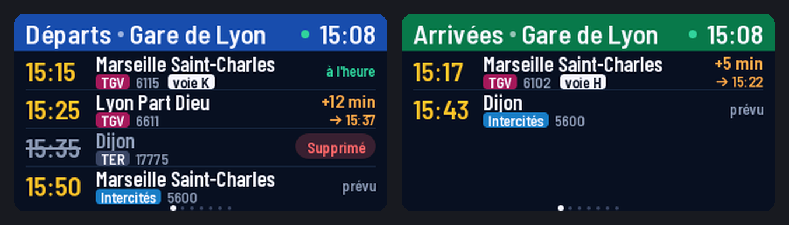
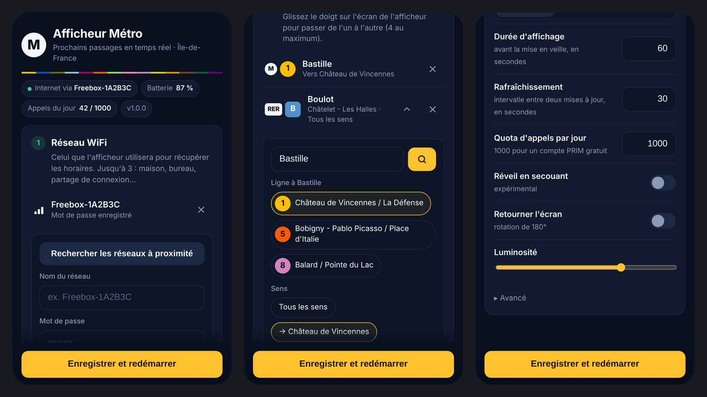
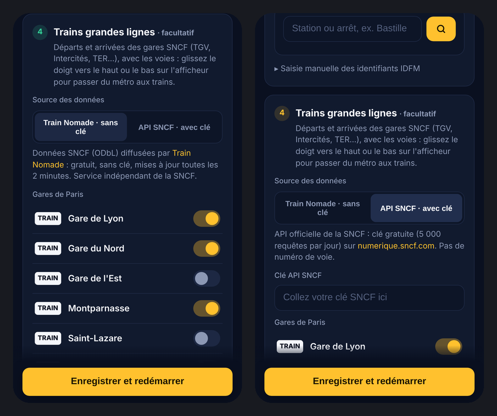
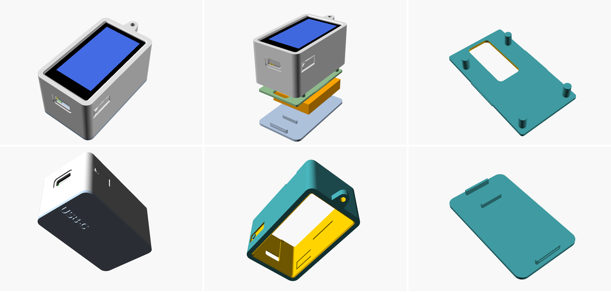

# Afficheur Métro

Un petit afficheur de poche, qui se commande au doigt :

- **Métro · RER · Tram** : on choisit sur l'écran la ligne, puis la station, et l'afficheur donne l'attente des **prochains passages dans chaque sens**, comme les écrans des quais. Toutes les lignes de métro, de RER et de tramway d'Île-de-France sont intégrées, stations dans l'ordre de la ligne, ainsi que les lignes 16, 17 et 18 du Grand Paris Express en construction (stations à venir avec leur année d'ouverture prévue) ;
- **Trains SNCF** : on choisit une grande gare (Paris et 138 autres) et l'afficheur donne ses **départs et arrivées**, comme les tableaux des gares ;
- **Info trafic** : les perturbations en cours sur le métro, le RER et le tram (travaux, trafic interrompu, arrêt non desservi…) et celles des 12 prochaines heures, avec le message complet ; un ⚠ s'affiche à côté de la ligne sur l'écran des passages ;
- **Mes arrêts / Mes gares** : des favoris réglés depuis le téléphone, pour y accéder en un geste.

Une flèche « ‹ » (ou glisser vers la droite) ramène à l'étape précédente, jusqu'à l'accueil où l'on change de réseau.

Matériel : **Waveshare ESP32-S3-Touch-LCD-1.9** (écran tactile 1,9" 170×320) et une batterie LiPo.
Données : **API PRIM d'Île-de-France Mobilités** (gratuite, clé personnelle) pour le métro, et **données SNCF diffusées par [Train Nomade](https://trainnomade.fr/api)** (gratuites, **sans clé**) pour les trains. L'API SNCF officielle reste utilisable en option.









*Rendus générés sur PC à partir du vrai code d'affichage (voir « Tests sur PC »).*

La configuration se fait depuis le téléphone :



## Fonctionnalités

- **Choix libre sur l'écran** : accueil → Métro, RER ou Tram → ligne (pastilles aux couleurs officielles) → station (liste dans l'ordre de la ligne, avec le tracé, les terminus et les branches) → prochains passages dans chaque sens (« puis 7 et 12 min »). Trains SNCF → initiale → gare → départs / arrivées.
- **Info trafic** (API PRIM « Messages Info Trafic », même clé, à ajouter à son abonnement sur le site PRIM) : une case de l'accueil, dont le bandeau prend les couleurs des lignes perturbées ; la liste des perturbations (en cours d'abord, les plus graves en tête, puis à venir avec l'heure de début) ; le message complet en touchant une ligne. Mise à jour toutes les 5 minutes pendant la consultation. La réponse de PRIM (plus d'1 Mo pour toute l'Île-de-France) est lue au fil de l'eau : seules les lignes de l'afficheur sont gardées.
- Deux prochains passages avec destination et attente en minutes, rafraîchis automatiquement.
- Mentions « À quai », « À l'approche » (clignotant), « Supprimé », « Retardé », voie (RER), « Horaire théorique » quand l'info n'est pas en temps réel.
- Pictogrammes de lignes aux couleurs officielles (métro, RER, Transilien, tram) ; bus et autres lignes acceptés.
- Jusqu'à **4 arrêts favoris** (glisser pour passer de l'un à l'autre), avec choix du sens.
- **Configuration depuis le téléphone** : l'afficheur crée son propre WiFi (QR code à l'écran). La page web permet de chercher une station par son nom et de choisir la ligne et le sens.
- Polices anti-aliasées avec tous les accents (« Château », « Défense », « Église »...).
- **Batterie** : niveau affiché, veille profonde après 60 s, réveil par le bouton BOOT (ou en secouant l'afficheur, expérimental). Au réveil, les derniers horaires s'affichent immédiatement pendant la reconnexion.
- Jusqu'à 3 réseaux WiFi (maison, bureau, partage de connexion du téléphone).
- Respect des quotas PRIM et SNCF (compteurs d'appels par jour).

**Programme Trains grandes lignes**

- Tableau des 4 prochains départs ou arrivées : heure, destination ou provenance, type de train (TGV INOUI, OUIGO, TGV Lyria, Intercités, TER…), numéro et **voie**.
- Retards (« +12 min », avec la nouvelle heure) et trains supprimés.
- Les trains pas encore suivis en temps réel (tôt le matin, par exemple) sont ajoutés d'après les horaires prévus, avec la mention « prévu ».
- Les 7 grandes gares parisiennes proposées d'office (Gare de Lyon, Gare du Nord, Gare de l'Est, Montparnasse, Saint-Lazare, Austerlitz, Bercy), et jusqu'à 10 gares en tout, cherchées par leur nom.
- Option « grandes lignes uniquement » qui masque RER, Transilien et autocars (activée par défaut).

## 1. Obtenir une clé API PRIM (gratuit)

1. Créez un compte sur [prim.iledefrance-mobilites.fr](https://prim.iledefrance-mobilites.fr).
2. Dans le catalogue, ouvrez l'API **« Prochains passages (plateforme Île-de-France Mobilités) - requête unitaire »** et abonnez-vous.
3. Dans « Mon compte » → « Mes jetons d'authentification », générez un jeton. C'est votre **clé API**.

> **Quota :** les comptes récents ont droit à **1000 appels par jour**. En usage « porte-clés » (on regarde l'écran 1 minute, il se rendort), on consomme 2 à 3 appels par consultation : c'est largement suffisant. Si vous voulez un affichage permanent, demandez une augmentation de quota à PRIM puis indiquez le nouveau quota dans les réglages.

### Trains grandes lignes : aucune clé nécessaire

Par défaut, les départs et arrivées viennent de **[Train Nomade](https://trainnomade.fr/api)**, un service indépendant qui rediffuse gratuitement et sans clé le flux temps réel ouvert de la SNCF (relevé toutes les 2 minutes, licence ODbL). Il fournit aussi les **voies** et, pour 145 grandes gares, les horaires prévus sur 14 jours. L'afficheur le consulte au plus une fois par minute, comme demandé, et télécharge les horaires prévus une fois par jour.

**Option : API SNCF officielle.** Pour l'utiliser à la place (sans les voies), demandez une clé via le formulaire « API SNCF » de [numerique.sncf.com/startup/api](https://numerique.sncf.com/startup/api/) (jeton de la forme `xxxxxxxx-xxxx-xxxx-xxxx-xxxxxxxxxxxx`, 5 000 requêtes par jour), puis choisissez « API SNCF (clé) » dans la configuration.

> ⚠️ La clé du portail **SNCF Open Data** (ressources.data.sncf.com, 56 caractères hexadécimaux) **ne convient pas** à l'API SNCF : elle sert aux jeux de données statiques. L'API des départs la refuse.

## 2. Installer le programme

### Avec l'IDE Arduino (le plus simple)

1. Installez l'[IDE Arduino 2](https://www.arduino.cc/en/software).
2. **Fichier → Préférences → URL de gestionnaire de cartes supplémentaires**, ajoutez :
   `https://espressif.github.io/arduino-esp32/package_esp32_index.json`
3. **Outils → Carte → Gestionnaire de cartes** : installez **esp32** par Espressif, **version 3.3.12** (3.0 minimum).
4. **Croquis → Inclure une bibliothèque → Gérer les bibliothèques** : installez
   - **LovyanGFX** (lovyan03), version 1.2.36 ou plus récente ;
   - **ArduinoJson** (Benoit Blanchon), version 7.x.
5. Ouvrez `Metro/Metro.ino`.
6. Réglez le menu **Outils** :

   | Réglage | Valeur |
   |---|---|
   | Carte | **ESP32S3 Dev Module** |
   | USB CDC On Boot | **Enabled** |
   | Flash Size | **16MB (128Mb)** |
   | Partition Scheme | **16M Flash (3MB APP/9.9MB FATFS)** |
   | PSRAM | **OPI PSRAM** |
   | Upload Mode | UART0 / Hardware CDC |

7. Branchez la carte en USB-C et cliquez sur **Téléverser**.
   Si le téléversement échoue : maintenez **BOOT**, appuyez brièvement sur **RESET**, relâchez BOOT, puis recommencez.

### Sans rien installer : binaire précompilé

**Mise à jour d'un afficheur déjà installé** (réglages conservés) : le dossier [`firmware/`](firmware/) contient le programme compilé avec TLS 1.3 (nécessaire pour PRIM, voir « État et limites »).

1. Téléchargez `firmware/metro-tls13-0x10000.bin` (bouton « Download raw file » sur GitHub).
2. Ouvrez [espressif.github.io/esptool-js](https://espressif.github.io/esptool-js/) dans Chrome ou Edge, branchez la carte, **Connect**.
3. Adresse **0x10000** (pas 0x0), choisissez le fichier, **Program** — sans « Erase Flash », qui effacerait les réglages.
4. Appuyez sur **RESET**.

**Installation complète** : si vous avez le fichier `metro-merged.bin` (image complète : chargeur de démarrage + table de partitions + programme) :

1. Ouvrez [espressif.github.io/esptool-js](https://espressif.github.io/esptool-js/) dans Chrome ou Edge.
2. Branchez la carte, cliquez sur **Connect** et choisissez le port USB (si rien n'apparaît : maintenez **BOOT**, appuyez sur **RESET**, relâchez BOOT).
3. Adresse **0x0**, fichier `metro-merged.bin`, puis **Program**.
4. Appuyez sur **RESET**.

En ligne de commande : `esptool.py --chip esp32s3 write_flash 0x0 metro-merged.bin`.

### Avec PlatformIO (VS Code)

Ouvrez le dossier du dépôt dans VS Code avec l'extension PlatformIO, puis :

```bash
pio run -t upload        # compile et téléverse
pio device monitor       # journal série (115200 bauds)
```

`platformio.ini` utilise la plateforme [pioarduino](https://github.com/pioarduino/platform-espressif32) (cœur Arduino ESP32 3.3.12) et télécharge les bibliothèques tout seul.

## 3. Configurer

Au premier démarrage, l'écran affiche un **QR code** et le nom d'un WiFi « Metro-XXXX ».

1. Scannez le QR code avec l'appareil photo du téléphone (ou rejoignez « Metro-XXXX » à la main). La page de configuration s'ouvre ; sinon, allez sur **http://192.168.4.1**.
2. **WiFi** : « Rechercher les réseaux », choisissez le vôtre, entrez le mot de passe, « Ajouter et se connecter ». Attendez « Connecté et enregistré ✓ » : le réseau est enregistré dès que la connexion réussit. L'écran de l'afficheur indique aussi le résultat (« WiFi : mot de passe refusé »…). Si le téléphone perd la page à ce moment (l'afficheur change de canal pour rejoindre la box), reconnectez-le à « Metro-XXXX », ou ouvrez l'adresse **http://192.168.…** affichée sur l'écran depuis le WiFi de la maison.
3. **Clé API PRIM** : collez votre jeton (nécessaire pour le métro, le RER et le tram ; pas pour les trains SNCF).
4. **Mes arrêts** (facultatif : toutes les lignes et stations se choisissent aussi sur l'afficheur) : tapez un nom de station (« Bastille ») : la liste des arrêts apparaît au bout d'une seconde (la recherche passe par l'afficheur, qui doit donc être connecté au WiFi : étape 1). Touchez l'arrêt, puis la ligne et, si vous voulez, les destinations à afficher, puis « Ajouter » : l'arrêt est enregistré aussitôt. Répétez pour 4 arrêts au plus.
   Pour un RER à plusieurs branches, cochez toutes les destinations d'un même sens (ex. RER A vers l'est : Marne-la-Vallée Chessy, Torcy, Boissy-Saint-Léger) : les données « Aller / Retour » du RER ne sont pas fiables.
   Les bus et Noctiliens sont reconnus : leur numéro et leur couleur viennent du référentiel des lignes IDFM.
5. **Trains grandes lignes** (facultatif) : cochez les gares de Paris voulues ; « Autre gare » permet d'en ajouter d'autres par leur nom (recherche dans l'open data SNCF, sans clé). Rien d'autre à faire avec la source Train Nomade.
6. **Enregistrer et redémarrer**.

Le WiFi suffit pour que l'afficheur démarre : le reste se choisit sur l'écran.



Pour revenir plus tard à la configuration : **appui long (3 s) sur l'écran** ou **bouton BOOT maintenu 3 s**. Les réglages déjà enregistrés sont conservés ; mots de passe et clé ne sont jamais réaffichés (laisser le champ vide = garder l'ancien).

> La recherche d'arrêts et la liste des lignes passent par l'afficheur, qui doit donc d'abord être connecté à votre WiFi (étape 2).
> Pour une saisie manuelle, l'identifiant d'arrêt peut être un `MonitoringRef` PRIM (`STIF:StopArea:SP:71517:`), un identifiant open data (`IDFM:463158`, `IDFM:monomodalStopPlace:58566`) ou un simple numéro de zone d'arrêt. La ligne est l'identifiant IDFM (`C01371` pour la ligne 1).

## 4. Utilisation

| Geste | Effet |
|---|---|
| Toucher une case, une ligne, une station, une gare | La choisir |
| Toucher la flèche « ‹ » en haut à gauche, ou glisser vers la droite | Retour à l'étape précédente (jusqu'à l'accueil) |
| Glisser vers le haut / le bas | Listes de stations et de gares : faire défiler · ailleurs : retour à l'accueil |
| Toucher l'écran des passages | Destinations suivantes (« sens 1/3 »), sinon actualiser |
| Toucher le tableau d'une gare | Départs ↔ Arrivées |
| Info trafic : toucher une perturbation | Message complet (glisser haut/bas pour le lire, toucher : perturbation suivante) |
| Glisser vers la gauche / la droite (Mes arrêts, Mes gares) | Favori suivant / précédent |
| Appui long sur l'écran (3 s) | Mode configuration |
| Bouton BOOT (appui court) | Réveiller / mettre en veille |
| Bouton BOOT maintenu 3 s | Mode configuration (ou en sortir) |

Passages : les destinations sont rangées d'un bout à l'autre de la ligne (deux par écran) ; sous chacune, les passages suivants. Le pied d'écran indique l'âge des données (« Il y a 12 s ») et la page de destinations (« sens 1/3 »).
Trains : bandeau bleu pour les départs, vert pour les arrivées ; la pastille à côté de l'heure est verte quand le tableau est à jour. Les gares de Paris sont regroupées sous « Paris », les autres par initiale.
Au réveil, l'afficheur reprend l'écran laissé (la station ou la gare choisie, avec ses derniers horaires pendant la reconnexion).

### Modes de veille (page de configuration)

- **Veille profonde** (défaut, sur batterie) : après la durée d'affichage (60 s), tout s'éteint. Réveil par BOOT, ou par une secousse si l'option est cochée. Consommation de veille très faible.
- **Écran éteint** (sur secteur) : l'écran s'éteint, un toucher le rallume.
- **Toujours allumé** (sur secteur) : l'intervalle de rafraîchissement est automatiquement allongé pour tenir dans le quota du jour (≈ 1 appel toutes les 87 s avec 1000 appels/jour).

## Dépannage

| Symptôme | Solution |
|---|---|
| Image à l'envers | Réglages → « Retourner l'écran (180°) » |
| « Clé API refusée (401/403) » | Vérifiez le jeton et l'abonnement à l'API « Prochains passages (requête unitaire) » |
| « Quota PRIM dépassé (429) » | Quota du jour épuisé : attendre minuit, ou réduire le rafraîchissement |
| Trains : « prévu » à droite | Le train n'est pas encore suivi en temps réel : c'est l'horaire prévu |
| Trains : « Données en direct indisponibles » | La source (flux SNCF ou Train Nomade) n'a pas été mise à jour récemment |
| Trains, source API SNCF : « Clé SNCF refusée (401) » | Vérifiez le jeton reçu par e-mail (pas la clé SNCF Open Data) |
| Trains, source API SNCF : « … » à la place de la provenance | Recherche en cours (une requête par train) |
| Trains, source API SNCF : pas de voie | L'API SNCF ne fournit pas les voies (Train Nomade, si) |
| « Aucun passage prévu » | Service terminé, ou temps réel indisponible sur cette ligne |
| « Horaire théorique » | IDFM ne fournit pas de temps réel pour ce passage, c'est l'horaire prévu |
| RER : « sens 1/2 » mélange des trains vers l'est et l'ouest | Dans la configuration, choisissez les destinations d'un même sens |
| « WiFi : réseau introuvable » / réseau absent de la liste | La carte ne capte que le WiFi 2,4 GHz : vérifiez que cette bande est active sur la box. Partage de connexion d'iPhone : activez « Maximiser la compatibilité » |
| Recherche d'arrêts : « L'afficheur ne répond pas » | Le téléphone a quitté le réseau « Metro-XXXX » (il préfère souvent un WiFi avec Internet) : reconnectez-le, ou ouvrez l'adresse http://192.168.… affichée sur l'écran depuis le WiFi de la maison |
| « Réseau : TLS refusé par prim.iledefrance-mobilites.fr (-0x…) » | PRIM est servi par Cloudflare ; le cœur Arduino précompilé ne gère que TLS 1.2. Flashez le binaire compilé avec TLS 1.3 (`tools/idf-build`, à l'adresse 0x10000 : les réglages sont conservés) |
| « Réseau : mémoire insuffisante pour HTTPS » ou étiquette rouge « PSRAM désactivée » | **Outils → PSRAM → OPI PSRAM**, puis téléverser à nouveau |
| Info trafic : « Info trafic refusée (403) » | Sur le site PRIM, abonnez votre clé à l'API « Messages Info Trafic » (gratuit) |
| « Réseau : réponse incomplète » | La connexion s'est coupée pendant le téléchargement : nouvel essai automatique ; si cela se répète, rapprochez-vous de la box |
| Recherche d'arrêts : « Réseau : … » | L'afficheur n'arrive pas à joindre l'open data IDFM : regardez le moniteur série (ligne « Recherche d'arrêts ») |
| « WiFi : mot de passe refusé » | Cochez « Afficher le mot de passe » pour le vérifier (majuscules, chiffres et symboles comptent) |
| « WiFi : sécurité non gérée » | Réseau d'entreprise (identifiant + mot de passe) ou WEP : non gérés ; utilisez le WPA2 ou le WPA3 personnel |
| La page de configuration se ferme pendant la connexion WiFi | Normal si l'afficheur change de canal : reconnectez le téléphone à « Metro-XXXX » ; le WiFi est déjà enregistré si l'écran affiche « ou http://… » |
| Compilation : « Croquis trop gros » / « text section exceeds available space » | Partition par défaut (1,2 Mo) : **Outils → Flash Size → 16MB**, puis **Partition Scheme → 16M Flash (3MB APP/9.9MB FATFS)** |
| Écran noir après téléversement | PSRAM mal réglée : choisir **OPI PSRAM** |

Journal de fonctionnement : moniteur série à 115200 bauds.

## Boîtier imprimable en 3D

Un boîtier de poche en trois pièces (coque, plaque de maintien de la carte et fond clipsés, logement pour une batterie 803040, ouvertures USB-C, BOOT et RST) est dans [`boitier/`](boitier/) : fichiers STL prêts à imprimer, modèle OpenSCAD paramétrique et notice de montage.



## Organisation du code

```
Metro/                  sketch Arduino (aussi le src_dir de PlatformIO)
├── Metro.ino           programme principal : WiFi, deux programmes, gestes, veille
├── config.h            broches de la carte et valeurs par défaut
├── board.h/.cpp        écran + tactile (LovyanGFX), batterie, IMU, veille profonde
├── siri.h/.cpp         décodage des réponses PRIM (SIRI Lite), choix des 2 passages
├── prim.h/.cpp         requêtes PRIM, recherche d'arrêts (open data IDFM)
├── sncf.h/.cpp         décodage des tableaux de gare (Train Nomade et API SNCF), horaires prévus
├── sncf_stations.h     les 145 grandes gares dont les horaires prévus sont publiés
├── reseau.h/.cpp      réseau embarqué : lignes, stations dans l'ordre, gares (choix sur l'écran)
├── reseau_data.h      39 lignes, 969 stations (généré par tools/make_reseau.py)
├── sncf_list_data.h    gares proposées sur l'écran (généré par tools/make_sncf_list.py)
├── sncf_api.h/.cpp     requêtes Train Nomade / API SNCF, recherche de gares (open data SNCF)
├── traffic.h/.cpp      info trafic PRIM : perturbations des lignes, texte des messages
├── net.h/.cpp          HTTPS, quotas d'appels quotidiens, réglage de l'horloge
├── ui.h/.cpp           dessin des écrans (tampon mémoire, sans scintillement)
├── lines.h/.cpp        lignes connues : nom, couleurs officielles
├── settings.h/.cpp     réglages (JSON en mémoire flash)
├── portal.h/.cpp       point d'accès WiFi, portail captif, API de la page web
├── portal_html.h       la page de configuration
└── fonts_metro.h       polices générées (ne pas modifier à la main)
tools/make_fonts.py     génère fonts_metro.h à partir de tools/fonts/
tools/make_reseau.py   génère reseau_data.h (open data IDFM : gares et tracés des lignes)
tools/make_sncf_list.py génère sncf_list_data.h
tools/portal_preview.py aperçu de la page de configuration sur PC (données fictives)
tools/idf-build/        compilation de vérification avec ESP-IDF
test/                   tests sur PC (décodage + rendu des écrans en images)
```

### Brochage de la carte (Waveshare ESP32-S3-Touch-LCD-1.9)

| Fonction | GPIO |
|---|---|
| LCD ST7789V2 : SCLK, MOSI, CS, DC, RST | 10, 13, 12, 11, 9 |
| Rétroéclairage (actif à l'état bas) | 14 |
| I2C (tactile CST816S 0x15, IMU QMI8658 0x6B) : SDA, SCL | 47, 48 |
| Tactile : INT, RST | 21, 17 |
| Tension batterie (pont ÷3) | 4 |
| Bouton BOOT | 0 |

## Tests sur PC

Le décodage des réponses PRIM et SNCF et le dessin des écrans se compilent aussi sur un PC Linux ou macOS, sans la carte :

```bash
cd test
make test   # tests du décodage (réponses d'exemple dans test/data/)
make ui     # rendu des écrans dans test/out/*.png
```

Il faut `g++` et les sources de ArduinoJson et LovyanGFX (chemins réglables : `make ARDUINOJSON=... LOVYANGFX=... ui`), plus Pillow (`pip install pillow`) pour les PNG.

Pour modifier les polices (taille, caractères) : `pip install pillow && python3 tools/make_fonts.py`.

Pour retoucher la page de configuration sans la carte : `python3 tools/portal_preview.py`, puis ouvrez http://localhost:8080 (données fictives, rien n'est envoyé).

## État et limites

- Le décodage PRIM et SNCF (tests avec sanitizers) et l'affichage (rendus ci-dessus) ont été vérifiés sur PC.
- L'**API PRIM réelle** a été interrogée le 8 novembre 2026 (La Défense, Bastille) : réponses correctement décodées ; une vraie réponse sert désormais de donnée de test (`test/data/prim_ladefense_reel.json`). La recherche d'arrêts et le référentiel des lignes de l'open data IDFM ont aussi été vérifiés.
- Le firmware complet **compile sans erreur ni avertissement** (`-Wall -Wextra`) pour l'ESP32-S3 avec ESP-IDF 5.5.6 + cœur Arduino 3.3.12 + LovyanGFX 1.2.36 + ArduinoJson 7.4.3 (binaire d'environ 1,8 Mo, 58 % de la partition de 3 Mo). Il démarre sur la carte (WiFi, page de configuration et recherche d'arrêts essayés) ; au moindre souci, regardez le moniteur série et signalez les erreurs.
- **Train Nomade** a été interrogé en vrai le 8 novembre 2026 (Gare de Lyon, Gare du Nord, horaires prévus, recherche de gares dans l'open data SNCF) : réponses correctement décodées, vraies réponses gardées comme données de test. C'est un service indépendant et gratuit, sans garantie de disponibilité ; l'affichage en gare fait foi.
- L'**API SNCF officielle** n'a pas pu être essayée (pas de clé valide) : ses données de test sont reconstituées d'après sa documentation (format Navitia) et des clients existants.
- Le **choix sur l'écran tactile** (zones de toucher) a été vérifié sur les rendus PC, pas encore sur la carte : si un toucher choisit la mauvaise case, le moniteur série affiche ses coordonnées (« Toucher (x, y) »).
- L'**ordre des stations** est reconstitué à partir des tracés de l'open data IDFM ; quelques lignes à boucle ou à branches (10, RER C et D) gardent un ordre approximatif. Pour mettre à jour la liste des lignes et des stations : `python3 tools/make_reseau.py`.
- Lignes **16, 17 et 18** (Grand Paris Express) : stations et années d'ouverture tirées des données des projets IDFM, dans l'ordre géographique. Les stations sans zone d'arrêt référencée affichent « Pas encore en service » ; les 16 et 17 ont un identifiant provisoire (`M16`, `M17`) à remplacer dans `tools/make_reseau.py` et `Metro/lines.cpp` quand IDFM les publiera, puis relancer le script. La ligne 15 peut s'ajouter de la même façon.
- **PRIM est désormais servi par Cloudflare** et refuse la connexion du cœur Arduino précompilé (« TLS refusé (-0x7780) ») : il faut un firmware compilé avec TLS 1.3. Le binaire `firmware/metro-tls13-0x10000.bin` (compilé avec `tools/idf-build`) se flashe à l'adresse 0x10000 avec [esptool-js](https://espressif.github.io/esptool-js/), sans effacer les réglages.
- Le **réveil par secousse** est expérimental : la séquence de l'IMU vient de notes de la communauté, et la broche d'interruption n'est pas confirmée. Si l'afficheur se réveille tout seul dans une poche, il suspend ce réveil 30 minutes après 3 réveils sans utilisation.
- Le sens d'affichage (paysage, USB à gauche ou à droite) dépend du montage : utilisez l'option « Retourner l'écran ».
- Les connexions HTTPS vérifient les certificats avec le magasin intégré au cœur ESP32 (versions 3.3.x). Si la connexion échoue, l'afficheur refait un essai sans vérification pour ne pas rester bloqué.

## Licences et sources

- Polices : [Barlow Semi Condensed et Barlow Condensed](https://github.com/jpt/barlow), SIL Open Font License 1.1 (`tools/fonts/OFL.txt`).
- Données : API PRIM et open data d'Île-de-France Mobilités (couleurs des lignes issues du référentiel IDFM) ; **données SNCF (ODbL), via Train Nomade** ; open data SNCF (gares de voyageurs) ; API SNCF (Navitia) en option. La mention « Données SNCF (ODbL) via Train Nomade » s'affiche sur l'afficheur à l'ouverture du programme Trains et dans la page de configuration.
- Bibliothèques : [LovyanGFX](https://github.com/lovyan03/LovyanGFX) (FreeBSD), [ArduinoJson](https://arduinojson.org) (MIT), [cœur Arduino ESP32](https://github.com/espressif/arduino-esp32) (LGPL 2.1).
- Projet indépendant, sans lien avec la RATP, IDFM, la SNCF ou les fabricants d'afficheurs du commerce.
