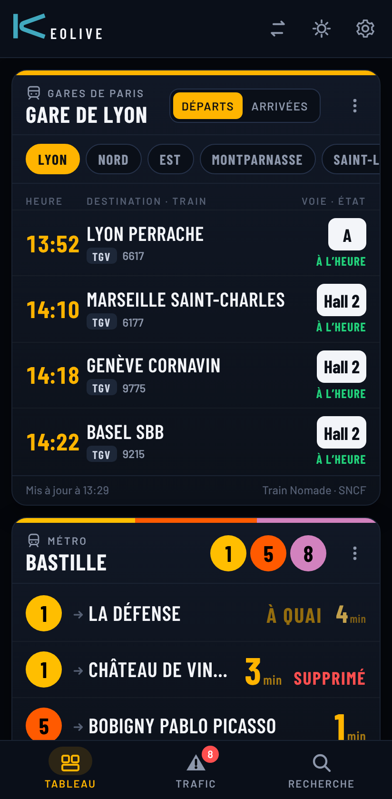
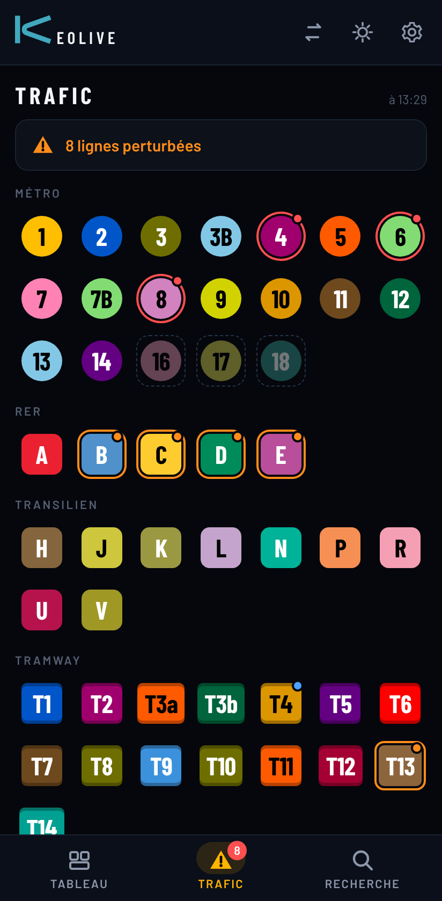
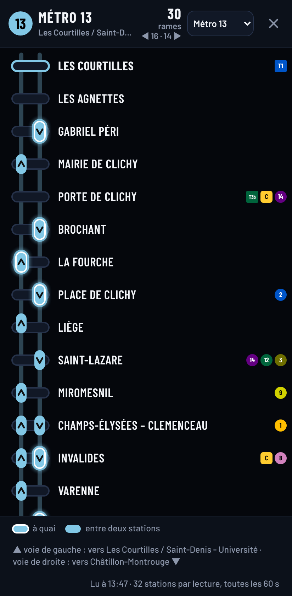
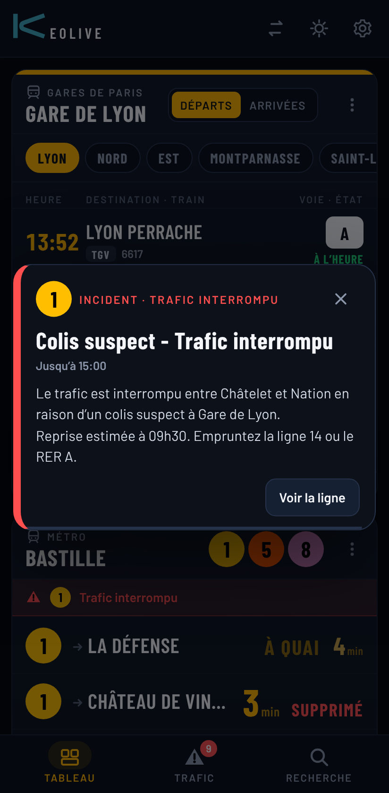
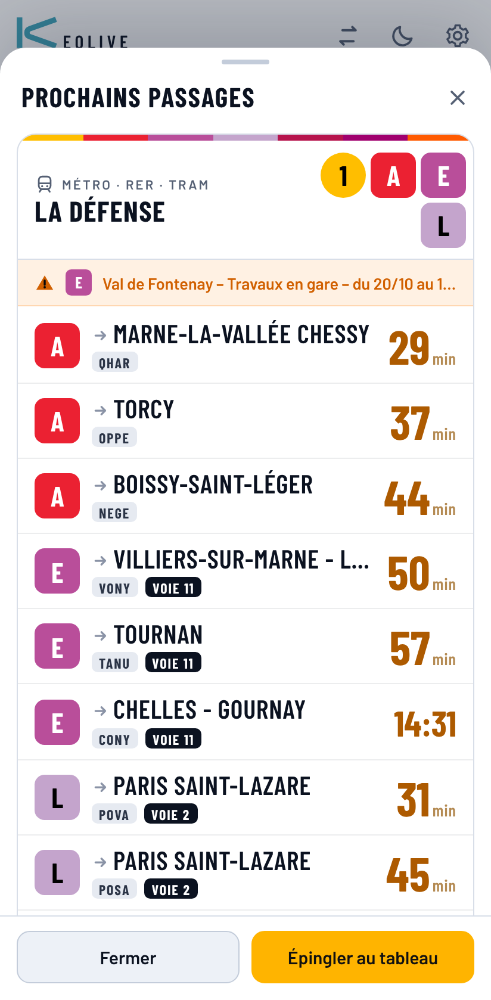

# KeoLive pour Android

**KeoLive** sur le téléphone : les prochains passages en Île-de-France et l'état du trafic, dans le style des écrans de quai, avec une interface conçue pour l'écran tactile et des **alertes d'incident par notification, même application fermée**.

| Tableau | Trafic | Plan de ligne | Alerte | Thème clair |
|---|---|---|---|---|
|  |  |  |  |  |

- **Tableau :** les arrêts épinglés, une carte sous l'autre, avec les minutes avant chaque passage, les missions et les voies, « À QUAI », « APPROCHE », « SUPPRIMÉ ». La carte **Grandes gares de Paris** (Lyon, Nord, Est, Montparnasse, Saint-Lazare, Austerlitz, Bercy) donne les départs ou les arrivées des grandes lignes : heure, destination, train, voie, retard. Pour déplacer une carte : appui long sur son titre, puis glissez ; le bouton ⋮ d'une carte propose aussi Actualiser, Monter, Descendre, Retirer.
- **Trafic :** toutes les lignes de métro, de RER, de Transilien et de tram, avec une pastille par ligne (les lignes 16, 17 et 18 du Grand Paris Express, pas encore ouvertes, sont grisées). Un toucher ouvre le détail des messages, et le bouton **Suivre** retient la ligne pour les alertes « Mes lignes ». Le nombre de lignes perturbées s'affiche sur l'onglet.
- **Plan de ligne :** une ligne de métro ou de tram à la fois, de haut en bas, une voie par sens, avec ses rames placées en station ou entre deux stations, qui avancent en temps réel. Voir « Plan de ligne » plus bas.
- **Recherche :** n'importe quelle station de métro, de RER ou de tram, une gare SNCF ou un arrêt de bus. Un aperçu s'ouvre, et **Épingler au tableau** l'ajoute.
- **Thème :** sombre ou clair (bouton soleil ou lune), ou **Automatique** comme le téléphone.
- **Bouton Retour du téléphone :** ferme la feuille, l'alerte ou le plan ouvert, revient au Tableau, puis laisse Android faire.

## Plan de ligne

- **Ouvrir :** onglet Trafic, touchez une ligne de métro (1 à 14, 3bis, 7bis) ou de tram (T1 à T14), puis **Plan**. Le menu en haut passe à une autre ligne ; le bouton Retour ferme le plan.
- **Lecture :** la ligne se lit de haut en bas. Voie de gauche : rames qui montent (vers le terminus du haut) ; voie de droite : rames qui descendent (rappel en bas de l'écran). Les branches (lignes 7 et 13, T4, T8) sont dessinées à la suite, sous la ligne principale, avec leur station de jonction en tête. Faites défiler pour voir toute la ligne. Si l'écran est assez large pour la ligne (tablette, ou téléphone en paysage pour une ligne courte), le plan passe à l'horizontale, comme sur Windows.
- **Les rames :** une capsule à la couleur de la ligne, flèche dans le sens de marche. Entourée de blanc : **à quai** ; pleine : **entre deux stations**, placée selon le temps qui lui reste avant la suivante. Touchez une rame : sa destination et sa prochaine station ; touchez le nom d'une station : ses prochains passages.
- **D'où viennent les positions :** PRIM ne donne pas la position des rames, seulement les heures des prochains passages à chaque station. KeoLive lit toutes les stations de la ligne et en déduit où se trouvent les rames : c'est une position **déduite des annonces**, pas un relevé GPS (détails dans la [notice Windows](../windows/README.md#plan-de-ligne)).
- **Mouvement :** chaque rame existe dans la durée : elle roule de station en station, accélère, freine, s'arrête à quai (25 s en métro, 20 en tram, une minute au plus), ne double ni ne rattrape jamais celle de devant et n'arrive à une station que 45 s au moins après le départ de la précédente. Les annonces ne règlent que son allure. Elle apparaît au terminus de départ (ou quand les annonces en montrent une absente du plan pendant plusieurs secondes) et disparaît au terminus, ou en fondu quand les annonces ne la montrent plus.
- **En direct :** chaque station est relue dès que PRIM renouvelle ses données, toutes les 30 secondes ; PRIM ne les met pas à jour plus souvent.
- **Quota :** en direct, deux appels par station et par minute (3 000 par heure pour la ligne 1), peu face au 1 000 000 d'appels par jour réglé par défaut. Si votre clé PRIM n'a droit qu'à 1 000 appels par jour, indiquez-le dans ⚙ Réglages : le plan ralentit alors (une lecture toutes les 10 à 30 minutes) et le dit. Sans ce réglage, PRIM refuse les appels en cours de journée ; KeoLive le signale et fait des pauses au lieu d'insister. Application en arrière-plan, le plan ne lit rien.

## Installation (hors Play Store)

KeoLive n'est pas sur le Play Store : c'est un fichier `KeoLive.apk` à installer soi-même (environ 300 Ko). Il faut Android 8.0 ou plus récent.

1. Sur le téléphone, téléchargez [`KeoLive.apk`](https://github.com/Jeff75019/Metro/raw/claude/esp32-metro-display-app-72ncxo/android/dist/KeoLive.apk).
2. Ouvrez le fichier téléchargé (notification « Téléchargement terminé », ou l'application Fichiers → Téléchargements). La première fois, Android demande d'**autoriser cette source** (Chrome ou Fichiers) à installer des applications inconnues : Paramètres → activez l'autorisation → revenez en arrière → **Installer**.
3. **Play Protect** peut afficher « Application non reconnue » ou « Analyser l'application » : KeoLive vient d'un développeur que Google ne connaît pas (comme SmartScreen pour la version Windows). Touchez **Plus de détails → Installer quand même**, ou **Analyser** puis Installer.
4. À la première ouverture, **autorisez les notifications** (nécessaires aux alertes), puis collez votre **clé PRIM** dans le bandeau jaune (voir ci-dessous). Allez dans **Recherche** et épinglez vos arrêts.

**Mettre à jour :** installez le nouvel `KeoLive.apk` par-dessus l'ancien, de la même façon. Réglages, clé et arrêts épinglés sont conservés.

**À venir chez Google :** Google met en place une [vérification des développeurs](https://support.google.com/android-developer-console/answer/16561738), même pour les applications installées hors Play Store, depuis le 30 septembre 2026 dans quatre pays (Brésil, Indonésie, Singapour, Thaïlande) et dans le reste du monde courant 2027. Quand elle arrivera en France, l'installation d'une application d'un développeur non vérifié passera par un parcours « avancé » prévu par Google, ou le projet devra être déclaré. D'ici là, rien ne change pour KeoLive.

## Clé PRIM (gratuite)

Les passages en temps réel et l'état du trafic viennent de PRIM, la plateforme d'Île-de-France Mobilités. Les trains SNCF n'en ont pas besoin.

1. Créez un compte sur [prim.iledefrance-mobilites.fr](https://prim.iledefrance-mobilites.fr).
2. Abonnez-vous aux API **« Prochains passages (requête unitaire) »** et **« Messages Info Trafic »**.
3. Dans « Mon compte », générez un jeton, puis collez-le dans KeoLive (bandeau jaune, ou ⚙ Réglages).

La même clé peut servir à l'afficheur ESP32 et à la version Windows ; le quota du jour est alors partagé.

## Alertes d'incident

- **Application à l'écran :** l'info trafic est relue toutes les 2 minutes ; dès qu'un incident touche une ligne (trafic perturbé ou interrompu), une fenêtre s'ouvre au centre de l'écran, avec un carillon et une vibration : lignes concernées, titre, période, message complet, bouton « Voir la ligne ». Elle se met à jour si l'incident s'aggrave, et annonce le retour à la normale.
- **Application en arrière-plan ou fermée :** Android relit l'info trafic **toutes les 15 minutes environ** (c'est le minimum qu'il accorde) et prévient par une **notification** : canal « Incidents » (sonore) pour un nouvel incident ou une aggravation, canal « Trafic rétabli » (discret) à la fin. Un toucher ouvre KeoLive sur la fiche de la ligne. Quand le téléphone dort depuis longtemps, Android peut espacer ces vérifications ; le bouton **Alertes plus régulières** des réglages lui demande de ne pas brider KeoLive.
- **Quelles lignes :** ⚙ Réglages → « Alertes d'incident » : **Toutes**, **Mes lignes** (celles des arrêts épinglés et celles que vous suivez) ou **Aucune** (plus de vérification en arrière-plan).
- **Au lancement**, et à la première vérification en arrière-plan, rien n'est annoncé : les incidents déjà en cours sont dans l'onglet Trafic. Seuls les changements donnent une alerte.
- **Quota :** chaque vérification en arrière-plan est un appel à l'API « Messages Info Trafic », soit une centaine par jour, en plus de ceux faits application ouverte.
- **Essai :** ⚙ Réglages → Notifications → **Essayer** envoie une notification d'essai. Si rien n'apparaît, vérifiez Paramètres Android → Applications → KeoLive → Notifications.

## Au travail : réseau

L'application contacte uniquement : `prim.iledefrance-mobilites.fr` (passages, info trafic), `api.trainnomade.fr` (trains), `data.iledefrance-mobilites.fr` et `ressources.data.sncf.com` (recherche des arrêts de bus et des gares). Rien d'autre, et aucune donnée personnelle n'est envoyée : la clé PRIM reste sur le téléphone.

## État des essais et limites

- **Pas encore lancée sur un vrai téléphone.** L'interface a été essayée dans Chromium (le moteur de la WebView d'Android) en taille de téléphone, avec des réponses PRIM réelles enregistrées et les données SNCF en direct ; le décodage de l'info trafic de la partie native a été testé sur ordinateur avec les mêmes réponses ; l'APK est vérifié (manifeste, signature, contenu). Le premier essai réel se fera sur votre téléphone : si l'application se ferme au lancement ou reste sur un écran vide, dites-le-moi, avec le modèle du téléphone et la version d'Android.
- **Plan de ligne :** essayé en direct sur la ligne 1 (dans Chromium), avec de vraies données de PRIM enregistrées sur les lignes 1 et 13, et avec des rames simulées sur toutes les lignes (voir la notice Windows) ; pas encore en direct sur un téléphone.
- Il faut une **WebView Android à jour** (« Android System WebView » ou Chrome, mis à jour par le Play Store).
- PRIM est protégé par un filtre anti-robots (Cloudflare) ; depuis un téléphone, il laisse passer l'application comme le navigateur.
- Pas de widget d'écran d'accueil pour l'instant.
- Données : Île-de-France Mobilités (PRIM, open data), SNCF (ODbL), Train Nomade. Polices Barlow (licence OFL).

## Pour les développeurs

```
AndroidManifest.xml   une activité (la page dans une WebView) et un service de tâche périodique
src/                  Java, API Android seulement (aucune bibliothèque tierce) :
  MainActivity        WebView servie sous https://app.keolive.example/, barres système, retour, notifications (permission)
  Bridge              fonctions offertes à la page (window.KeoAndroid)
  AlertJob            JobScheduler : lecture de l'info trafic toutes les 15 min, comparaison, notifications
  Incidents           décodage PRIM disruptions_bulk (Java pur, testable sur ordinateur)
  Notifier, Prefs     canaux et notifications ; réglages partagés avec la page
web/                  l'interface mobile (HTML, CSS, JavaScript) ; data.js, polices et logo viennent de ../windows/app
res/                  icône adaptative (tools/make_icons.py), thème, textes
tools/                make_icons.py, lines_json.py, IncidentsTest.java
keystore/             clé de signature du propriétaire (hors dépôt, voir ci-dessous)
dist/                 KeoLive.apk et son empreinte SHA-256
```

- **Compiler sous Linux :** `./build.sh`. Il faut un JDK 17 ou plus, python3 (avec Pillow pour les icônes) et le SDK Android : `cmdline-tools`, puis `sdkmanager "platforms;android-35" "build-tools;35.0.0"` ; chemin dans `ANDROID_SDK` (par défaut `../../toolchain/android`). Pas de Gradle : aapt2, javac, d8, zipalign et apksigner sont appelés directement.
- **Essayer l'interface dans un navigateur :** après `./build.sh`, servez la racine du dépôt (`python3 -m http.server`) et ouvrez `android/build/assets/www/index.html?demo` en mode « appareil mobile » des outils de développement. `?demo` remplace PRIM par des réponses réelles enregistrées (`test/data/`) ; `demoIncident(2)` dans la console simule un incident sur la ligne 1.
- **Tester le décodage de l'info trafic :** voir l'en-tête de `tools/IncidentsTest.java` (bibliothèque `org.json` de Maven Central).
- **Clé de signature :** Android n'installe une mise à jour que si elle est signée avec la **même clé** que la version en place. La clé (`keystore/keolive.jks`) et son mot de passe (`keystore/keolive.pass`) ne sont **pas dans le dépôt** : ils sont gardés par le propriétaire de l'application. Pour compiler une mise à jour installable par-dessus l'existante, remettez ces deux fichiers dans `android/keystore/` avant `./build.sh` (ou indiquez-les par `KEOLIVE_KEYSTORE` et `KEOLIVE_KEYSTORE_PASS`). Sans eux, `build.sh` crée une nouvelle clé : l'APK s'installe, mais seulement après avoir désinstallé l'ancienne version.
