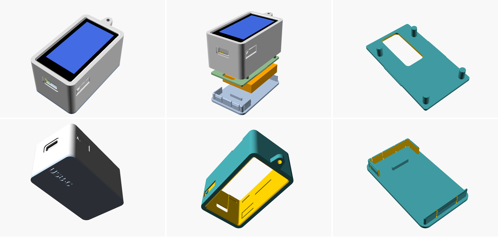
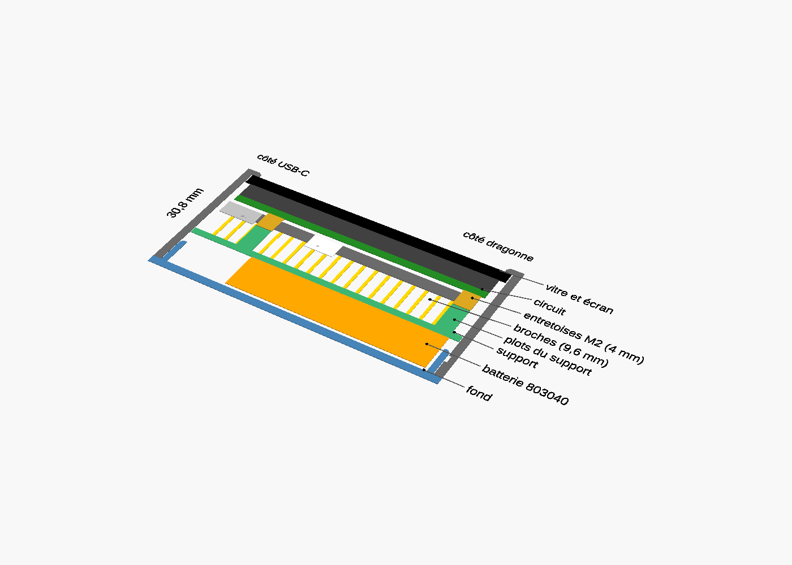
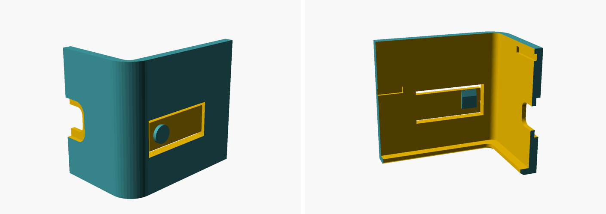

# Boîtier imprimable en 3D

Boîtier de poche pour la carte **Waveshare ESP32-S3-Touch-LCD-1.9** (livrée avec ses barrettes de broches et ses entretoises M2 au dos) et sa batterie LiPo **803040** (40 × 30 × 8 mm, 1000 mAh), en trois pièces :

- la **coque** (avant et côtés) ;
- le **support**, une plaque clipsée dans la coque derrière les broches de la carte : ses 4 plots appuient sur les entretoises M2 et tiennent la carte contre la vitre, une fenêtre laisse passer le câble de la batterie ;
- le **fond**, tenu par un rebord qui suit tout le tour intérieur de la coque (à 0,15 mm des parois) et le cale en long comme en travers. Cinq languettes découpées dans ce rebord portent un ergot près de leur bout, qui se clipse dans une rainure de la coque : deux sur les grands côtés (côté USB-C), deux sur le petit côté USB-C, une au milieu du petit côté opposé. Le rebord ne s'interrompt que le long de la batterie, qui touche presque les grands côtés. Le fond cale aussi la batterie.



- Encombrement : **58,7 × 35,1 × 30,8 mm** (65,7 mm de long avec le passant de dragonne).
- Fenêtre sur toute la vitre tactile (rebord de 1,4 mm), dégagement pour la fiche USB-C.
- **Boutons BOOT et RST intégrés à la coque** : sur chaque grand côté, une languette souple découpée dans la paroi porte une pastille ronde sous le doigt. On appuie du doigt, sans pointe : la languette plie et pousse le bouton de la carte.
- Les broches restent en place : le support passe derrière leurs pointes (0,6 mm de jeu) et la batterie se pose sur le support, qui la protège des pointes. Côté USB-C, une place est laissée pour le surplus de câble.





- Cotes de la carte : [plan officiel Waveshare](https://docs.waveshare.com/ESP32-S3-LCD-1.9) (version Touch).

## Fichiers

| Fichier | Contenu |
|---|---|
| `coque.stl` | coque, à imprimer face avant sur le plateau |
| `support.stl` | plaque de maintien, à imprimer plots vers le haut |
| `fond.stl` | fond, à imprimer face extérieure (gravée « USB-C ») sur le plateau |
| `boitier.scad` | modèle paramétrique [OpenSCAD](https://openscad.org) (logiciel libre) |
| `apercus/` | images des aperçus |

## Avant d'imprimer : mesures à vérifier

Les STL sont prévus pour la carte telle que Waveshare la livre (broches et entretoises) et une batterie **803040**. Si votre montage est différent, ouvrez `boitier.scad` dans OpenSCAD, changez les valeurs en tête de fichier, puis exportez à nouveau (F6, puis « Exporter en STL ») :

| Paramètre | Valeur prévue | Comment le mesurer |
|---|---|---|
| `bat_long`, `bat_larg`, `bat_ep` | 40 × 30 × 8 | dimensions de la batterie (souvent écrites dessus : « 803040 » = 8 mm × 30 mm × 40 mm) ; jusqu'à 48 × 31 mm à plat |
| `broches` | 9,6 | du dos du circuit au bout des broches ; 0 si la carte n'a pas de barrettes |
| `entretoise` | 4,0 | hauteur des entretoises en laiton au dos ; 0 s'il n'y en a pas |
| `dos_carte` | 7,8 | de la face avant de la vitre au dos du circuit (hors prise USB-C) |
| `jeu` | 0,25 | jeu autour de la vitre : 0,3 si votre imprimante « gonfle » les trous |
| `course` | 0 | poussoir sous les languettes des boutons (voir ci-dessous) |
| `ergot` | 0,4 | saillie des ergots du fond : 0,5 s'il se déclipse trop facilement, 0,3 s'il est trop dur à ouvrir (coque et fond à réimprimer) |
| `boutons_souples` | true | `false` pour revenir à de simples trous (appui avec une pointe) |

**Boîtier plus fin** : les broches ne servent pas dans ce montage. Si vous les coupez à la pince coupante au ras de leur support en plastique noir, mettez `broches = 3` : le boîtier perd près de 6 mm d'épaisseur (25,0 mm). Les entretoises restent.

**Réglage des boutons** : carte montée, le bouton doit cliquer quand on appuie sur la pastille et se relâcher seul. La languette est au ras de la paroi : les poussoirs blancs des boutons de la carte arrivent presque au bord de la vitre, et toute saillie à l'intérieur les toucherait au repos. Si le bouton ne se déclenche vraiment pas, essayez `course = 0.2` (seule la coque est à réimprimer).

Pour exporter en ligne de commande :

```bash
openscad -D 'piece="coque"'   -o coque.stl   boitier.scad
openscad -D 'piece="support"' -o support.stl boitier.scad
openscad -D 'piece="fond"'    -o fond.stl    boitier.scad
```

## Impression

- PLA ou PETG, couche de 0,2 mm, 3 périmètres, remplissage 20 %.
- **Sans support d'impression** : coque face avant sur le plateau, support plots vers le haut, fond face gravée sur le plateau.
- Conseil : imprimez d'abord la coque seule et vérifiez que la carte s'y pose bien à plat, vitre contre le rebord, et que la prise USB-C tombe en face de son ouverture.
- Ne bouchez pas les fines fentes autour des languettes : ce sont elles qui rendent les boutons souples. Si un fil d'impression en bouche une, dégagez-la au cutter.

## Montage

1. **Vérifiez la polarité de la batterie** avant de la brancher : les fiches JST/MX 1,25 mm ne sont pas câblées pareil chez tous les vendeurs. Le rouge (+) doit aller sur le « + » marqué au dos de la carte à côté du connecteur BAT. Une inversion détruit le circuit de charge.
2. Posez la carte dans la coque, écran en premier, la prise USB-C en face de son ouverture. Elle doit descendre seule jusqu'au rebord de la fenêtre et y rester à plat : si un bout reste en l'air, quelque chose frotte, ne forcez pas.
3. Branchez la batterie sur la carte et passez son câble par la fenêtre du support.
4. Enfoncez le support, plots vers la carte : les plots viennent sur le bout des entretoises (il ne se monte que dans un sens) et la plaque se clipse dans la coque, juste derrière les pointes des broches.
5. Posez la batterie à plat sur le support, **le côté des fils vers l'USB-C** : le surplus de câble se range dans la place libre de ce côté, au milieu, entre les languettes du fond.
6. Présentez le fond, « USB-C » gravé du côté de la prise : son rebord entre dans la coque et le centre tout seul. Appuyez sur les bords jusqu'au clic des cinq languettes (les deux du petit côté USB-C, celle du côté opposé et les deux des grands côtés). Bien clipsé, il affleure la coque et ne bouge plus.
7. Pour ouvrir : glissez un ongle ou un tournevis plat dans l'encoche du grand côté et soulevez ; les ergots ont une face inclinée côté fond, ils se déclipsent en forçant un peu.

BOOT et RST s'actionnent du doigt, par les pastilles rondes des grands côtés (côté USB-C).

## Limites

- Version 3 : fixation du fond refaite après essai (il jouait en travers et se déclipsait : les deux pattes de 3 mm ne pouvaient presque pas fléchir). Le rebord sur tout le tour et les cinq languettes de 6 mm, dont les ergots sont près du bout, remplacent les pattes et les butées. Coque et fond sont à réimprimer, le support est inchangé. Version 2 : broches et entretoises au dos, carte de travers à cause des poussoirs des boutons, fond qui glissait en travers. Établie d'après le plan du fabricant et des photos de la carte : la longueur des broches (9,6 mm) et la position des boutons sont mesurées sur ces images, à quelques dixièmes de millimètre près.
- Ne comprimez pas et ne percez pas la batterie : laissez-lui un peu de jeu (prévu : 0,6 mm), et ne la posez jamais directement contre les pointes des broches.
