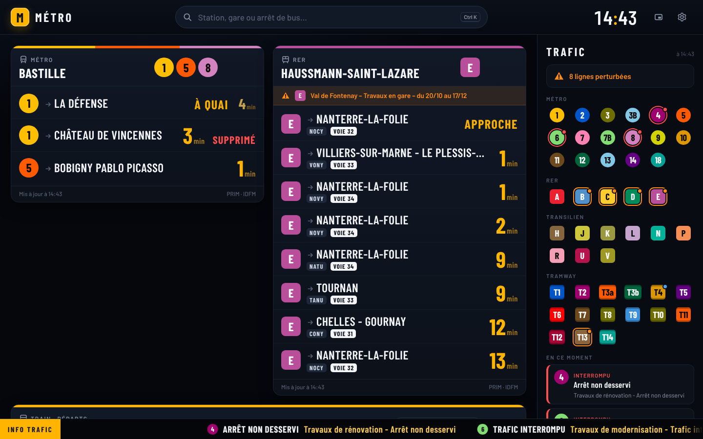
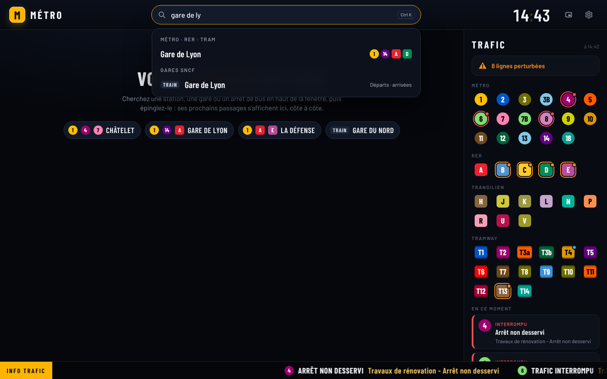
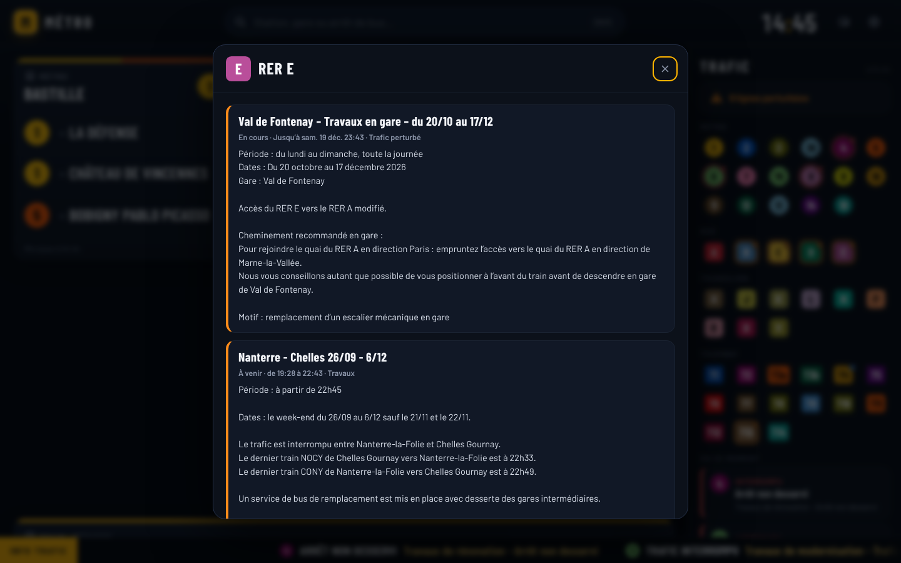
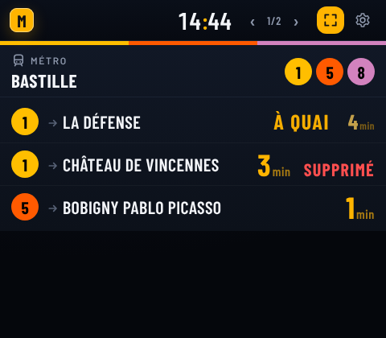

# Métro pour Windows

Tableau de bord des prochains passages en Île-de-France pour Windows 10 et 11, dans l'esprit des écrans de quai : fond sombre, très grands chiffres, couleurs des lignes.



- **Recherche libre :** n'importe quelle station de métro, de RER ou de tram, une gare SNCF ou un arrêt de bus (`Ctrl K`). Un aperçu s'ouvre, et le bouton **Épingler** l'ajoute au tableau.
- **Tableau :** les arrêts épinglés côte à côte, avec les minutes avant chaque passage, les missions et les voies du RER, « À QUAI », « APPROCHE » et « SUPPRIMÉ ». On les réordonne en les faisant glisser par leur titre.
- **Trains SNCF :** départs et arrivées d'une gare (TGV, Intercités, TER), avec l'heure, la voie, le retard ou la suppression.
- **État du trafic :** toutes les lignes de métro, de RER, de Transilien et de tram, avec une pastille de couleur par ligne. Un clic donne le détail des messages. Un bandeau défilant rappelle les perturbations en cours.
- **Mode compact (`M`) :** une petite fenêtre en haut à droite de l'écran, une carte à la fois (flèches ← →). L'option « toujours au premier plan » (`T`) la garde visible par-dessus vos autres fenêtres.

| Recherche | Détail d'une ligne | Mode compact |
|---|---|---|
|  |  |  |

## Installation

1. Téléchargez [`Metro.exe`](https://github.com/Jeff75019/Metro/raw/claude/esp32-metro-display-app-72ncxo/windows/dist/Metro.exe) (moins de 1 Mo, un seul fichier, sans installation ni droits d'administrateur).
2. Double-cliquez dessus. L'application n'est pas signée : au premier lancement, Windows affiche « Windows a protégé votre ordinateur ». Cliquez sur **Informations complémentaires**, puis sur **Exécuter quand même**.
3. Collez votre **clé PRIM** dans le bandeau jaune (voir ci-dessous), puis cherchez une station.

L'application utilise WebView2, le moteur d'Edge, présent d'office dans Windows 11. Les réglages et la position de la fenêtre sont gardés dans `%LOCALAPPDATA%\Metro`.

**Sans `.exe` :** si votre poste de travail interdit les programmes téléchargés, ouvrez [`Metro.html`](dist/Metro.html) dans Edge. C'est la même application, dans le navigateur, sans le mode « premier plan ».

## Clé PRIM (gratuite)

Les passages en temps réel et l'état du trafic viennent de PRIM, la plateforme d'Île-de-France Mobilités. Les trains SNCF n'ont pas besoin de clé.

1. Créez un compte sur [prim.iledefrance-mobilites.fr](https://prim.iledefrance-mobilites.fr).
2. Abonnez-vous aux API **« Prochains passages (requête unitaire) »** et **« Messages Info Trafic »**.
3. Dans « Mon compte », générez un jeton, puis collez-le dans l'application (bandeau jaune, ou ⚙ Réglages).

La même clé peut servir à l'afficheur ESP32 : le quota du jour est alors partagé.

## Quota et rafraîchissement

- Chaque arrêt est mis à jour toutes les 60 secondes par défaut (30, 60 ou 120 s dans les réglages).
- L'application compte ses appels du jour. Si le quota risque de manquer avant 20 h, elle ralentit d'elle-même, en répartissant ce qui reste sur la journée.
- Quand la fenêtre est réduite, plus aucun appel n'est fait.
- Le quota par défaut est de 1000 appels par jour ; mettez celui de votre abonnement PRIM dans les réglages. L'info trafic est relue toutes les 5 minutes, sur son propre quota.

## Raccourcis

| Touche | Action |
|---|---|
| `Ctrl K` ou `/` | rechercher |
| `↑` `↓` `Entrée` | choisir un résultat |
| `M` | mode compact / tableau complet |
| `←` `→` | carte précédente / suivante (mode compact) |
| `T` | toujours au premier plan |
| `F5` | actualiser |
| `Échap` | fermer |
| `Ctrl` + molette | agrandir ou réduire l'affichage |

## Au travail : réseau et pare-feu

L'application passe par la connexion de Windows : le proxy de l'entreprise est suivi comme dans Edge. Elle n'interroge que ces adresses :

- `prim.iledefrance-mobilites.fr` : passages et info trafic ;
- `data.iledefrance-mobilites.fr` : recherche des arrêts de bus, noms et couleurs des lignes de bus ;
- `ressources.data.sncf.com` : recherche des gares SNCF ;
- `api.trainnomade.fr` : départs et arrivées SNCF.

Si une carte affiche « PRIM injoignable (réseau ou pare-feu) », c'est que le réseau de l'entreprise bloque l'une de ces adresses : demandez au service informatique de l'autoriser.

## Pour les développeurs

```
app/            l'application (HTML, CSS, JavaScript, polices Barlow sous licence OFL)
  data.js       lignes, stations et gares, générées depuis le projet (tools/)
native/         la fenêtre Windows (C++, WebView2) : icône, premier plan, mode compact
tools/          bundle.py (application en un seul fichier), make_data.py, dump_reseau.cpp
dist/           Metro.exe et Metro.html, prêts à l'emploi
```

- **Compiler sous Linux :** `make`. Il faut MinGW-w64 (`g++-mingw-w64-x86-64-posix`), la bibliothèque [webview](https://github.com/webview/webview) 0.12 et le SDK WebView2 (paquet NuGet `Microsoft.Web.WebView2`). Les chemins sont en tête du `Makefile`.
- **Essayer l'interface dans un navigateur :** servez la racine du dépôt (`python3 -m http.server`) et ouvrez `windows/app/index.html`. Avec `?demo`, les réponses PRIM sont remplacées par des réponses réelles enregistrées (`test/data/`) et remises à l'heure.
- **Mettre à jour les stations :** `g++ -I../Metro -I<ArduinoJson>/src tools/dump_reseau.cpp ../Metro/reseau.cpp ../Metro/lines.cpp ../Metro/siri.cpp -o dump`, puis `./dump | python3 tools/make_data.py ../Metro/lines.cpp > app/data.js`.

## Limites

- **Pas encore lancée sur un vrai Windows.** L'interface a été essayée dans Chromium, le moteur de WebView2, avec des réponses PRIM réelles enregistrées et les données SNCF en direct. L'exécutable a été démarré sous Wine (sans WebView2) : il prépare la page et affiche correctement le message prévu quand le moteur manque. Le premier essai réel se fera sur votre PC.
- PRIM est protégé par un filtre anti-robots (Cloudflare). Depuis un poste normal, il laisse passer l'application comme le navigateur ; s'il bloquait un réseau d'entreprise, les cartes afficheraient « PRIM injoignable ».
- Données : Île-de-France Mobilités (PRIM, open data), SNCF (ODbL), Train Nomade.
