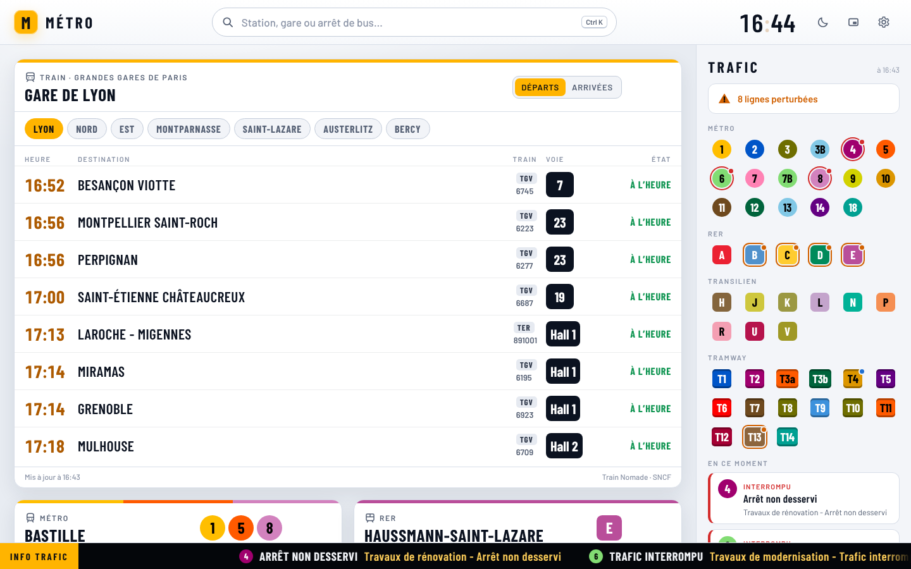
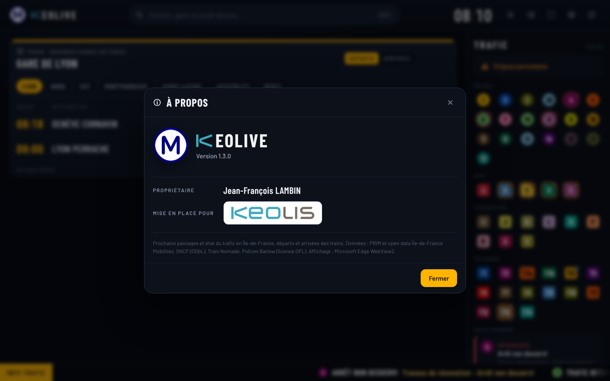
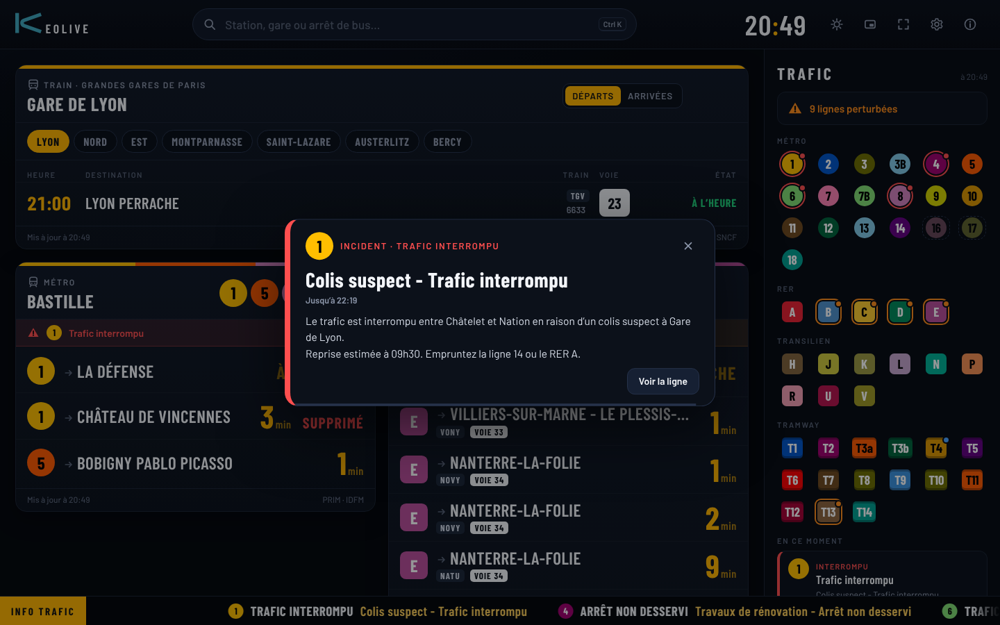

# KeoLive

**KeoLive** est un tableau de bord des prochains passages en Île-de-France pour Windows 10 et 11, dans l'esprit des écrans de quai : très grands chiffres, couleurs des lignes, thème sombre ou clair.


- **Recherche libre :** n'importe quelle station de métro, de RER ou de tram, une gare SNCF ou un arrêt de bus (`Ctrl K`). Un aperçu s'ouvre, et le bouton **Épingler** l'ajoute au tableau.
- **Tableau :** les arrêts épinglés côte à côte, avec les minutes avant chaque passage, les missions et les voies du RER, « À QUAI », « APPROCHE » et « SUPPRIMÉ ». On les réordonne en les faisant glisser par leur titre.
- **Grandes gares de Paris :** une carte, présente d'office sur le tableau, avec un onglet par gare (Lyon, Nord, Est, Montparnasse, Saint-Lazare, Austerlitz, Bercy). On y voit les départs ou les arrivées des grandes lignes : heure, destination ou provenance, train, voie, retard ou suppression. Elle ne demande pas de clé.
- **Autres gares SNCF :** n'importe quelle gare, par la recherche, avec les mêmes informations.
- **État du trafic :** toutes les lignes de métro, de RER, de Transilien et de tram, avec une pastille de couleur par ligne. Les lignes 16, 17 et 18 du Grand Paris Express, pas encore ouvertes, y figurent grisées en pointillés ; leur fiche donne l'ouverture prévue (18 : 2027 ; 16 et 17 : automne 2028), le premier tronçon et les stations. Un clic donne le détail des messages. Un bandeau défilant rappelle les perturbations en cours.
- **Alertes d'incident :** dès qu'un incident touche une ligne (trafic perturbé ou interrompu), une fenêtre s'ouvre au centre de l'application, avec un carillon, et donne les lignes concernées, le titre, la période et le message complet. Elle se met à jour si l'incident s'aggrave et annonce le retour à la normale. Si KeoLive n'est pas au premier plan, Windows affiche une notification ; un clic dessus ouvre la fiche de la ligne. Voir « Alertes » plus bas.
- **À propos (bouton ⓘ, ou clic sur le logo) :** version de l'application, propriétaire et entreprise.
- **Thème clair ou sombre (`L`) :** le bouton soleil ou lune de l'en-tête bascule entre les deux. Dans les réglages, « Automatique » suit le thème de Windows.
- **Plein écran (`F11`) :** tout l'écran, par-dessus la barre des tâches, sans bordure ni barre de titre (bouton à quatre coins de l'en-tête), pour un écran dédié. Le curseur se cache après 3 secondes sans bouger la souris. On en sort par `F11`, `Échap` ou le même bouton. Si vous fermez l'application en plein écran, elle se rouvre ainsi.
- **Toutes les tailles de fenêtre :** la recherche reste au centre de l'en-tête, avec KeoLive à sa gauche. Dans une fenêtre étroite (moins de 960 pixels de large, ou un écran réglé à 150 %), l'en-tête passe sur deux lignes : KeoLive, l'horloge et les boutons en haut, la recherche dessous. Les cartes, le bandeau de la clé et les réglages se mettent sur une seule colonne.
- **Mode compact (`M`) :** une petite fenêtre en haut à droite de l'écran, une carte à la fois (flèches ← →). L'option « toujours au premier plan » (`T`) la garde visible par-dessus vos autres fenêtres.

| Thème clair | Recherche | Détail d'une ligne |
|---|---|---|
|  |  |  |

| À propos | Mode compact |
|---|---|
|  |  |

## Installation

1. Téléchargez [`KeoLive.exe`](https://github.com/Jeff75019/Metro/raw/claude/esp32-metro-display-app-72ncxo/windows/dist/KeoLive.exe) : environ 750 Ko, **un seul fichier**, sans installation ni droits d'administrateur.
2. Double-cliquez dessus, puis collez votre **clé PRIM** dans le bandeau jaune (voir ci-dessous) et cherchez une station.

L'application utilise WebView2, le moteur d'Edge, présent d'office dans Windows 11. Les réglages et la position de la fenêtre sont gardés dans `%LOCALAPPDATA%\KeoLive` : remplacer l'exécutable par une nouvelle version ne les efface pas. Les anciennes versions y recopiaient la page, dans un sous-dossier `app` que vous pouvez supprimer. Un fichier `KeoLive.html` laissé à côté de l'exécutable par la version 2.0.0 ne sert plus.

**Sans `.exe` :** si votre poste de travail interdit les programmes téléchargés, ouvrez [`KeoLive.html`](dist/KeoLive.html) dans Edge. C'est la même application, dans le navigateur, sans le mode « premier plan » ni les notifications de Windows.

## Si Windows se méfie ou annonce un virus

**Pourquoi.** Windows juge un programme d'abord sur sa **réputation** : un `.exe` jamais vu, téléchargé et **non signé** par un éditeur connu est traité comme suspect. Les détections de Microsoft Defender dont le nom finit par `!ml` (par exemple `Trojan:Win32/Wacatac.H!ml`) sont des suppositions d'un modèle automatique sur ce genre de fichier, pas la reconnaissance d'un virus connu. Exemple : les versions 1.5.4 et 1.5.5 avaient exactement le même code ; seule la page incluse changeait, et l'une est passée, l'autre a été détectée.

**Ce qui a été fait (version 2.1.0)** pour que l'exécutable ait la forme d'un programme Windows ordinaire :

- **édition des liens par lld**, l'éditeur de liens de LLVM (celui de Chrome, Firefox ou Rust) : en-tête et sections comme les programmes Windows courants, au lieu de la disposition propre à l'outil GNU, fréquente chez les logiciels malveillants compilés sous Linux ;
- **la page incluse comme une simple donnée**, et non plus comme une ressource opaque de 530 Ko (la forme habituelle des programmes qui en déposent un autre) ; elle est aussi **allégée** : 340 Ko, polices limitées à l'alphabet latin, images à la taille où elles s'affichent ;
- **aucune fonction sensible** : pas de bibliothèque qui suspend des processus ou modifie leur exécution, aucune écriture de fichier en dehors de la position de la fenêtre ;
- **compilation reproductible** : les mêmes sources redonnent exactement le même fichier.

Cela réduit nettement le risque sans pouvoir l'annuler : sans signature, chaque nouvelle version reste un fichier que Windows n'a jamais vu.

**Si Defender le signale quand même :**

1. **Vérifiez que c'est bien le fichier publié :** dans PowerShell, `Get-FileHash .\KeoLive.exe` doit donner l'empreinte écrite dans [`dist/KeoLive.exe.sha256`](dist/KeoLive.exe.sha256).
2. **Signalez le faux positif à Microsoft :** sur [microsoft.com/wdsi/filesubmission](https://www.microsoft.com/wdsi/filesubmission), envoyez `KeoLive.exe` (« Incorrectly detected as malware ») avec le nom de la détection (Sécurité Windows → Protection contre les virus et menaces → **Historique de protection**). Microsoft répond en général en quelques jours et retire la détection pour ce fichier, pour tout le monde.
3. **Sur un poste Keolis,** l'antivirus est géré par le service informatique : il peut autoriser `KeoLive.exe`, ou le signer avec le certificat de code de l'entreprise, ce qui règle durablement la détection et l'avertissement SmartScreen. Ne désactivez pas l'antivirus.

**L'avertissement SmartScreen** (« Windows a protégé votre ordinateur ») n'est pas une détection de virus : Windows ne connaît pas encore le programme. **Informations complémentaires → Exécuter quand même**, ou, avant le premier lancement, clic droit sur `KeoLive.exe` → Propriétés → cocher **Débloquer**.

**Ce que fait l'exécutable :** il ouvre une fenêtre, y affiche la page de l'application avec WebView2 et enregistre la position de la fenêtre. Il ne modifie ni le registre ni les autres programmes, n'écrit aucun autre fichier et ne se lance pas au démarrage de Windows. Les seules adresses contactées sont celles de la section « Au travail : réseau et pare-feu », plus bas. Le code source complet est dans ce dossier (`native/` et `app/`).

## Clé PRIM (gratuite)

Les passages en temps réel et l'état du trafic viennent de PRIM, la plateforme d'Île-de-France Mobilités. Les trains SNCF n'ont pas besoin de clé.

1. Créez un compte sur [prim.iledefrance-mobilites.fr](https://prim.iledefrance-mobilites.fr).
2. Abonnez-vous aux API **« Prochains passages (requête unitaire) »** et **« Messages Info Trafic »**.
3. Dans « Mon compte », générez un jeton, puis collez-le dans l'application (bandeau jaune, ou ⚙ Réglages).

La même clé peut servir à l'afficheur ESP32 : le quota du jour est alors partagé.

## Alertes d'incident



- **Au lancement :** aucune fenêtre ; les incidents déjà en cours sont dans la colonne Trafic et le bandeau défilant. Une fenêtre ne s'ouvre que lorsqu'une ligne devient perturbée pendant que KeoLive tourne.
- **Où :** au centre de l'application, plus grande, avec un léger voile sur le tableau (on peut continuer à cliquer derrière).
- **Son :** un court carillon à chaque fenêtre : trois notes descendantes pour un incident, quatre pour une aggravation, deux notes montantes pour un trafic rétabli. Réglage « Son des alertes » dans ⚙ Réglages (avec « Écouter » pour l'essayer). La notification de Windows, elle, reste silencieuse pour ne pas sonner deux fois.
- **Ensuite :** une fenêtre par nouvel incident, puis « Aggravation » s'il passe de perturbé à interrompu, et « Trafic rétabli » à la fin. Une fenêtre se ferme seule au bout d'environ une minute (elle attend tant que la souris est dessus) ; « Voir la ligne » ouvre tous les messages de la ligne.
- **Quelles lignes :** dans ⚙ Réglages, « Alertes d'incident » : **Toutes** (par défaut), **Mes lignes** ou **Aucune**. « Mes lignes » regroupe les lignes des arrêts épinglés et celles que vous suivez : ouvrez la fiche d'une ligne (clic sur sa pastille dans la colonne Trafic) et cliquez sur **Suivre cette ligne**.
- **En arrière-plan :** fenêtre réduite ou cachée derrière d'autres, KeoLive continue de lire l'info trafic et prévient par une notification de Windows ; son bouton clignote dans la barre des tâches. Une icône KeoLive reste près de l'horloge : un clic dessus ramène la fenêtre.
- **Pas de notification de Windows ?** Elles sont sans doute coupées : Paramètres → Système → Notifications, ou mode « Ne pas déranger ».
- **Délai :** l'info trafic est relue toutes les 2 minutes quand les alertes sont actives. Une alerte arrive donc au plus 2 minutes après la publication de l'incident par Île-de-France Mobilités.

## Quota et rafraîchissement

- Chaque arrêt est mis à jour toutes les 60 secondes par défaut (30, 60 ou 120 s dans les réglages).
- L'application compte ses appels du jour. Si le quota risque de manquer avant 20 h, elle ralentit d'elle-même, en répartissant ce qui reste sur la journée.
- Quand la fenêtre est réduite, les passages ne sont plus demandés ; seule l'info trafic continue, pour les alertes.
- Le quota par défaut est de 1000 appels par jour ; mettez celui de votre abonnement PRIM dans les réglages. L'info trafic est relue toutes les 2 minutes (5 minutes si les alertes sont coupées), sur son propre quota, y compris fenêtre réduite.

## Raccourcis

| Touche | Action |
|---|---|
| `Ctrl K` ou `/` | rechercher |
| `↑` `↓` `Entrée` | choisir un résultat |
| `F11` | plein écran (par-dessus la barre des tâches) |
| `Échap` | quitter le plein écran, fermer une fenêtre |
| `M` | mode compact / tableau complet |
| `←` `→` | carte précédente / suivante (mode compact) |
| `T` | toujours au premier plan |
| `L` | thème clair / sombre |
| `F5` | actualiser |
| `Ctrl` + molette | agrandir ou réduire l'affichage |

## Au travail : réseau et pare-feu

L'application passe par la connexion de Windows : le proxy de l'entreprise est suivi comme dans Edge. Elle n'interroge que ces adresses :

- `prim.iledefrance-mobilites.fr` : passages et info trafic ;
- `data.iledefrance-mobilites.fr` : recherche des arrêts de bus, noms et couleurs des lignes de bus ;
- `ressources.data.sncf.com` : recherche des gares SNCF ;
- `api.trainnomade.fr` : départs et arrivées SNCF.

Si une carte affiche « PRIM injoignable (réseau ou pare-feu) », c'est que le réseau de l'entreprise bloque l'une de ces adresses : demandez au service informatique de l'autoriser.

## Pour les développeurs

```
app/            l'application (HTML, CSS, JavaScript, polices Barlow sous licence OFL)
  data.js       lignes, stations et gares, générées depuis le projet (tools/)
native/         la fenêtre Windows (C++, WebView2) : icône, premier plan, mode compact ; page.S inclut la page
tools/          bundle.py (application en un seul fichier), make_data.py, dump_reseau.cpp
sources/        icône et logo Keolis en grand format (l'application en utilise des versions réduites)
dist/           KeoLive.exe (l'application complète) et KeoLive.html (la même, pour un navigateur)
```

- **Compiler sous Linux :** `make`. Il faut MinGW-w64 en version « win32 » (`g++-mingw-w64-x86-64-win32`, et non « posix », dont la bibliothèque de threads ressemble pour les antivirus à un programme qui s'injecte dans d'autres), lld, l'éditeur de liens de LLVM (paquet `lld`), la bibliothèque [webview](https://github.com/webview/webview) 0.12 et le SDK WebView2 (paquet NuGet `Microsoft.Web.WebView2`). Les chemins et les choix de fabrication sont expliqués en tête du `Makefile`. La compilation est reproductible (date fixée par `SOURCE_DATE_EPOCH`, à avancer à chaque version).
- **Essayer l'interface dans un navigateur :** servez la racine du dépôt (`python3 -m http.server`) et ouvrez `windows/app/index.html`. Avec `?demo`, les réponses PRIM sont remplacées par des réponses réelles enregistrées (`test/data/`) et remises à l'heure.
- **Mettre à jour les stations :** `g++ -I../Metro -I<ArduinoJson>/src tools/dump_reseau.cpp ../Metro/reseau.cpp ../Metro/lines.cpp ../Metro/siri.cpp -o dump`, puis `./dump | python3 tools/make_data.py ../Metro/lines.cpp > app/data.js`.

## Limites

- **Essais :** l'interface a été essayée dans Chromium, le moteur de WebView2, de 360 à 1920 pixels de large, avec des réponses PRIM réelles enregistrées et les données SNCF en direct. L'exécutable tourne sur Windows 11 (version 1.5.4 : la page servie depuis la mémoire s'affiche). La version 2.1.0, fabriquée avec lld, a été lancée sous Wine (démarrage, page incluse vérifiée octet par octet, message prévu quand WebView2 manque), pas encore sur un vrai Windows. Les notifications de Windows et le son n'ont pas encore été vérifiés sur un vrai poste.
- PRIM est protégé par un filtre anti-robots (Cloudflare). Depuis un poste normal, il laisse passer l'application comme le navigateur ; s'il bloquait un réseau d'entreprise, les cartes afficheraient « PRIM injoignable ».
- Données : Île-de-France Mobilités (PRIM, open data), SNCF (ODbL), Train Nomade.
